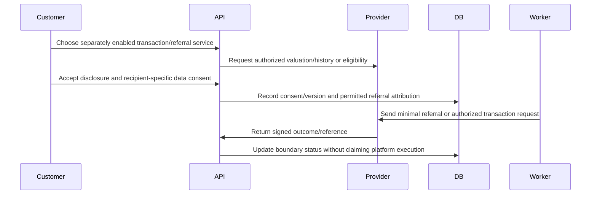

---
{
  "id": "DOC-02-REQUIREMENTS-WORKFLOWS-VEHICLE-TRANSACTION-REFERRAL",
  "title": "Vehicle transaction and financial referral",
  "status": "draft",
  "version": "1.0.0",
  "owner_role": "R03",
  "reviewer_roles": [
    "R03",
    "R13"
  ],
  "scope_ids": [
    "AUTO-07",
    "ECO-01"
  ],
  "source_refs": [
    "S00"
  ],
  "assumption_refs": [
    "A01"
  ],
  "updated": "2026-10-28"
}
---

# Vehicle transaction and financial referral

## Preconditions and authority
Each valuation/listing/auction/contract/debt-settlement and financial-referral capability has its own reviewed authority, provider and feature control; all direct regulated execution remains off absent approval.

## Exact sequence

## Commit boundaries and concurrency
Each DB mutation shown is a bounded local transaction. External provider calls occur outside it, with a persisted stable business operation identity and immutable schema/mapping version. Reauthorize resources and field projections on every read, callback application and operator action. Lock the relevant aggregate and use expectedVersion to prevent stale decisions. Money, audit and outbox writes belonging to one decision commit together. The [canonical state machines](../state-machines.md) govern payment/purchase/issuance separately; product-specific insurer state maps must retain provenance.

## Failure, disablement and compensation
Referral click is not investment execution or loan approval. Auction acceptance requires independent contract and settlement design; debt settlement unknown results block replay. Withdrawal of optional consent prevents future sharing but retains required audit references under reviewed retention.
New activity follows current discovery/quote/purchase controls. A committed obligation follows its accepted commercial version plus current security quarantine. Retry only classified transient, idempotent work. Record unknown external outcomes and owner before any replay. Notification failure never rolls back money or reissues a policy.

## Testable acceptance
AC-WF-REFERRAL: Enabling valuation never enables auctions or escrow; absent provider authority the operation rejects before data transmission and explains unavailable service.
Run with two users, two organizations and one dual-membership user. Revoke the initiating grant before a later asynchronous action and verify current access without losing the durable business obligation. Repeat the callback and crash after local commit; confirm no lost event or duplicate financial effect. Expected evidence: request identities, immutable event sequence, redacted audit trail and ledger/coverage assertions.

## Operations and performance
R20 owns customer-facing exceptions; R09 owns partner transport; R12 owns money exceptions; R11 owns suspected disclosure. Escalate unresolved outcomes with preserved partner references and request hashes. Apply PERF-READ/PERF-WRITE to own-service calls and PERF-QUOTE/PERF-DISPATCH only to their named boundaries in [central budgets](../../_meta/performance-budgets.yaml). No provider-dependent delay is hidden in an internal latency claim. These are specified tests, not executed application evidence.
