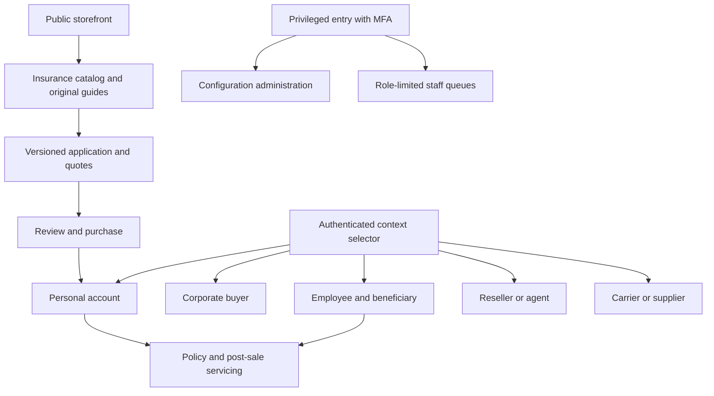

---
{
  "id": "EXP-IA",
  "title": "Information architecture",
  "status": "draft",
  "version": "1.0.0",
  "owner_role": "R04",
  "reviewer_roles": [
    "R07",
    "R11",
    "R13",
    "R21"
  ],
  "scope_ids": [
    "DSH-01",
    "DSH-02",
    "DSH-03",
    "DSH-04",
    "DSH-05",
    "DSH-06",
    "INS-01",
    "GRW-08"
  ],
  "source_refs": [
    "S00"
  ],
  "assumption_refs": [
    "A01"
  ],
  "updated": "2026-10-28"
}
---

# Information architecture

## Surface boundaries

The proposed presentation consists of public storefront, authenticated portal and privileged administration surfaces. The [architecture overview](../04-architecture/architecture-overview.md) owns application/deployment boundaries; these navigation groups do not require separate domain backends. Next.js renders authorized data; NestJS remains the authority for business decisions.

Public navigation includes insurance categories, original insurer profiles, comparison education, permitted assisted requests, original content/search, help and separately controlled automotive services. It never exposes private application URLs in a sitemap. Adjacent referrals and vehicle trading are separate labeled destinations with capability/authority checks; their presence does not imply direct regulated execution.

## Context and navigation rules

The context selector lists only currently valid personal/organization/distributor/carrier/beneficiary relationships. A person can have several; the current role and organization are visible. Insurer identity is not a corporate-buyer role. Selecting a context reauthorizes it, cancels outstanding reads and clears protected client state. A deep link to another context asks for an explicit permitted switch before exposing resource data. Search, counts, breadcrumbs and recently viewed items share the same authorization filter as their destination.

Within each dashboard, navigation is task-based: policy/benefit records, current work, money where permitted, support and settings. The [seven dashboard specifications](dashboards/customer.md) supply exact routes; the [route inventory](screen-and-route-inventory.md) is the cross-surface index. Menu/widget/action/report configuration is versioned, but only hides or arranges server-granted capabilities. It cannot grant a permission or change a domain state.

## Channel modes and state visibility

All four combinations of B2C/B2B sales are valid. Public catalog/editorial visibility, quotation, purchase, assisted sales, contracted servicing and partner delivery are separate decisions. A disabled sales path explains availability and gives permitted support/servicing navigation; it must not look like an empty portfolio. Existing orders, installments, claims and policy documents remain discoverable according to entitlement. A security quarantine has a different explanation and operational owner.

Orders expose independent payment, submission, underwriting, issuance and delivery statuses. Policy pages show confirmed effective coverage only. Marketing cards cannot override these labels. Corporate commitment distinguishes invoice/credit approval from paid cash receipt. Every public or dashboard route has a defined unauthenticated, forbidden, disabled, expired and error behavior; no raw identifier or private title leaks on denied routes.

## Acceptance and change control

AC-EXP-IA-CONTEXT: two users, two organizations and personal policies exercise every context switch and direct link; no old-context data appears in DOM, response, counts or history restoration. AC-EXP-IA-MODES: every navigation group is tested in all four sales-mode combinations plus independent subchannels and servicing. AC-EXP-IA-CONFIG: a menu proposal referencing an unknown route/action or unauthorized audience fails publication. R04 reviews labels/structure, R11 access implications and R13 route coverage; unreviewed decisions remain draft.

## Channel labels and canonical codes

Human-facing channel labels in these specifications map to the wire/domain codes below. API requests, events, persisted context and synthetic canonical examples use the canonical code; labels are display vocabulary, not extra enum values. `B2B` is an umbrella sales mode, not a sixth purchasable channel. A carrier/supplier organization is a commercial relationship, not a channel. An employee's separate personal purchase uses `b2c`; existing beneficiary servicing retains its coverage relationship independently of new-sales availability.

| Display/document label | Canonical code | Parent mode |
|---|---|---|
| B2C | `b2c` | B2C new sales |
| B2B.commercial | `commercial` | B2B plus commercial subchannel |
| B2B.corporate | `corporate` | B2B plus corporate subchannel |
| B2B.reseller | `reseller` | B2B plus reseller subchannel |
| B2B2C | `b2b2c` | B2B plus B2B2C new enrollment; contracted servicing evaluated separately |

Role/context selection never manufactures a channel entitlement. Unknown or display-label values at a strict canonical API boundary are rejected with a typed validation error rather than silently guessed. Import/adapters may translate an explicitly versioned label mapping before canonical validation and record the mapping version.
