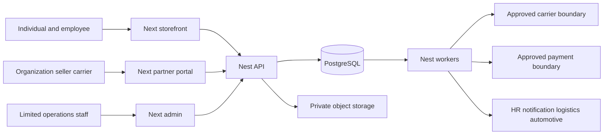
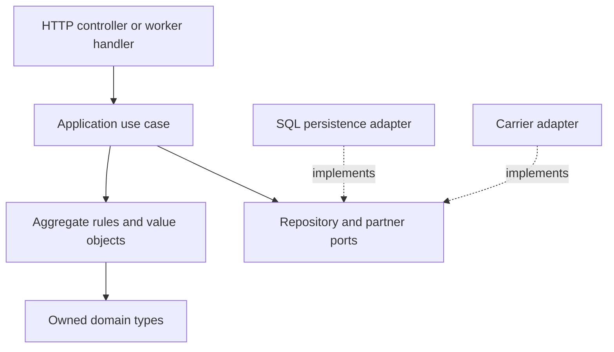

---
{
  "id": "DOC-04-C4-CONTEXT-CONTAINERS-COMPONENTS",
  "title": "Context, containers and components",
  "status": "proposed",
  "version": "1.0.0",
  "owner_role": "R05",
  "reviewer_roles": [
    "R13",
    "R17"
  ],
  "scope_ids": [
    "CHN-01",
    "CHN-02",
    "CHN-05",
    "INT-01",
    "INT-07"
  ],
  "source_refs": [
    "S00",
    "S01",
    "S02",
    "S03",
    "S04",
    "S09"
  ],
  "assumption_refs": [
    "A01"
  ],
  "updated": "2026-10-28"
}
---

# Context, containers and components

External systems are independent authorities. The payment provider confirms captured money; the insurer confirms issuance and effective coverage. Neither authority substitutes for the other. A carrier portal user is a scoped external actor, not an internal administrator. API-only carriers use the same capability and recipient policies without portal membership. Component boundaries are logical boundaries, not a requirement to create additional network services. Acceptance ARCH-C4-01: every public operation identifies one owning module and one authorized route to its data; no Next process holds transactional database credentials.
