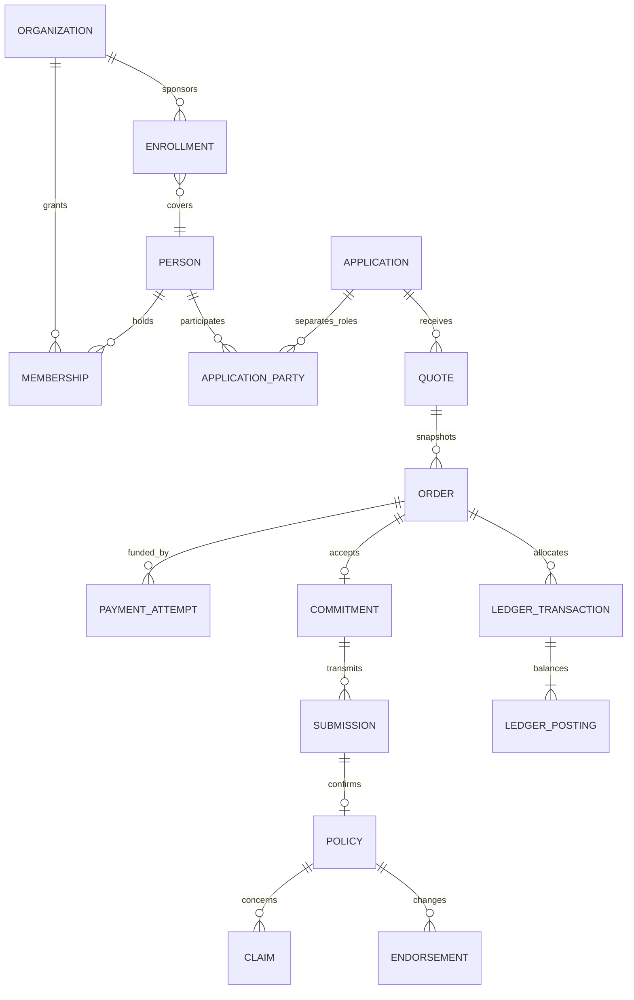

---
{
  "id": "DOC-05-DOMAIN-MODEL-AND-ERD",
  "title": "Domain model and entity relationships",
  "status": "proposed",
  "version": "1.0.0",
  "owner_role": "R10",
  "reviewer_roles": [
    "R13",
    "R17"
  ],
  "scope_ids": [
    "INT-01",
    "COM-09",
    "ORG-04",
    "SVC-06"
  ],
  "source_refs": [
    "S00"
  ],
  "assumption_refs": [
    "A01"
  ],
  "updated": "2026-10-28"
}
---

# Domain model and entity relationships

`application_party.role` explicitly enumerates buyer, payer, requester, approver, policyholder, insured, beneficiary and distributor; the carrier is attached to offer/submission rather than inferred from a payer. A party may refer to a person or organization with one-of validation. Membership never implies an insured relationship. Asset subjects have separate typed vehicle/property/device/equipment/project/shipment records with immutable application snapshots.

Versioned catalog/forms/coverage/rating/mapping/consent records are referenced by transactions. Integration attempts, outbox/inbox, file metadata, approvals, inventory reservations and job leases are independent entities. Deleting an account cannot cascade-delete financial evidence. Data dictionary and aggregate boundaries govern constraints; diagram cardinalities do not authorize access.
