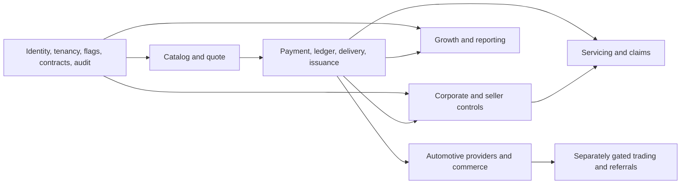

---
{
  "id": "DOC-14-DELIVERY-DEPENDENCY-MAP-AND-VERTICAL-SLICES",
  "title": "Dependency map and vertical slices",
  "status": "draft",
  "version": "1.0.0",
  "owner_role": "R18",
  "reviewer_roles": [
    "R03",
    "R13"
  ],
  "scope_ids": [
    "ALL"
  ],
  "source_refs": [
    "S00"
  ],
  "assumption_refs": [
    "A01"
  ],
  "updated": "2026-10-28"
}
---

# Dependency map and vertical slices

S0 includes testable privilege revocation and all four sales-mode combinations. S1 demonstrates progressive offers with one provider unavailable. S2 must survive payment callback duplication and crash-after-commit, and retain unknown insurer outcomes. S3 tests employer/employee privacy and maker-checker credit semantics. S4 adds product-specific endorsements, renewal and claims with authority restrictions. S5 cannot expose transactional data through analytics. S6 distinguishes bookings/stock/receipts from insurance issuance. S7 requires separate regulatory/provider decisions; native applications remain an independent scope decision.

Every slice includes a vertical path through presentation, Nest use case, owned persistence, tests, telemetry and operator recovery. No stage is considered done by adding routes alone. Deferred products remain in registry and backlog.
